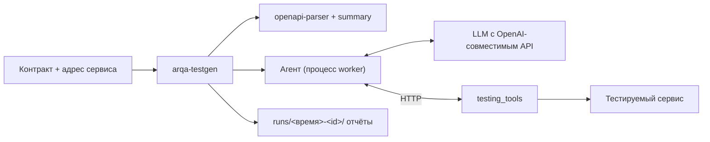

# ARQA-1

Система автоматического тестирования REST API по OpenAPI-контракту. Пользователь даёт
контракт и адрес сервиса; LLM-агент изучает контракт, запускает инструменты
тестирования через отдельный сервис и сохраняет отчёт с находками и метриками.

> **Состояние.** Работают чтение и разбор контракта, подготовка контекста для модели,
> агент с вызовом инструментов (Schemathesis, Microcks), прогон и оценка готового набора
> pytest (runner, мутационное тестирование, метрики), отчёты и журнал. **Генератора
> pytest-тестов и самокоррекции пока нет**: агент исследует API инструментами, но своих
> тестов не пишет. Подробно по каждому пункту ПМИ — [docs/pmi-report.md](docs/pmi-report.md),
> известные дефекты компонентов — [docs/known-issues.md](docs/known-issues.md).

## Из чего состоит

| Пакет | Каталог | Что делает | Как пользоваться |
|---|---|---|---|
| `agent` | `backend/agent` | CLI `arqa-testgen` и LangChain-агент: читает контракт, готовит summary, вызывает модель и инструменты, пишет отчёты | [README](backend/agent/README.md) |
| `openapi-parser` | `backend/openapi-parser` | Разбор OpenAPI 3.x: операции, параметры, схемы, статистика, summary для LLM | [README](backend/openapi-parser/README.md) |
| `testing-tools` | `backend/testing_tools` | HTTP-сервис инструментов: Schemathesis, Microcks, runner и мутационное тестирование pytest-наборов, метрики, архив прогонов | [README](backend/testing_tools/README.md) |
| демо-сервисы | `demo/` | Petstore и Orders с заранее известными дефектами — эталон для Fault Detection Rate | [README](demo/README.md) |
| приёмка | `tests/acceptance` | Автотесты по контрольным примерам ПМИ А-1…А-25 | [README](tests/acceptance/README.md) |

Все пакеты — участники одного uv workspace и ставятся одной командой из общего `uv.lock`.

## Как это работает



1. `arqa-testgen generate` читает контракт из файла или по URL, проверяет его parser'ом
   и строит компактное summary: операции, схемы, ограничения, примеры, связи. Полный
   контракт в модель не отправляется.
2. CLI запускает агента в отдельном процессе с лимитами времени и шагов.
3. Агент общается с моделью и сам решает, какой инструмент вызвать. С `--tools-url` он
   отправляет задание в testing_tools: тот запускает Schemathesis или Microcks против
   сервиса и возвращает находки, покрытие и метрики. Модель получает сжатую сводку,
   полные результаты сохраняются на диск. Без `--tools-url` инструменты демонстрационные.
4. CLI пишет в каталог прогона `report.json`, `report.md`, `manifest.json` (версии,
   хеши, параметры), `events.jsonl` (журнал этапов, вызовов LLM и инструментов) и
   артефакты инструментов. Каждый запуск — новый каталог, прошлые не меняются.

testing_tools можно использовать и без агента: это обычный REST API
([docs/API.md](backend/testing_tools/docs/API.md)). Через него, например, оценивается
готовый набор pytest: Runnability, Mutation Score, Contract Coverage.

## Быстрый старт

Нужны Python 3.13+, [uv](https://docs.astral.sh/uv/) и Git; для демо-стенда — Docker.

```bash
git clone https://github.com/OsipShmel/arqua-1.git
cd arqua-1
uv sync --locked --all-packages --all-extras
uv run --locked arqa-testgen --help
```

`uv sync --locked` ставит зависимости строго из `uv.lock`. Без `--all-packages
--all-extras` ставятся только пакеты, без инструментов разработки (pytest, ruff, mypy).

### Модель

Скопируйте [backend/agent/.env.example](backend/agent/.env.example) в `.env` в корне
и заполните:

```dotenv
DEEPCODE_API_KEY=ключ провайдера
DEEPCODE_BASE_URL=https://адрес-провайдера/v1
DEEPCODE_MODEL=имя модели с поддержкой tool calling
```

Подходит любой OpenAI-совместимый API, в том числе локальный (Ollama:
`DEEPCODE_BASE_URL=http://localhost:11434/v1`). `.env` в Git не попадает. Проверка
настроек без запросов к провайдеру: `uv run --locked arqa-testgen doctor`.

### Демо-стенд и прогон

```bash
docker compose up --build -d
```

Поднимаются testing_tools (`http://localhost:8000`, Swagger — `/docs`), Microcks
(`http://localhost:8585`) и два демо-сервиса (`localhost:18081`, `localhost:18082`).
Затем:

```bash
uv run --locked arqa-testgen generate http://localhost:18081/openapi.yaml \
  --base-url http://petstore:8080 --tools-url http://localhost:8000/api/v1 \
  --tools schemathesis microcks --tools-timeout 300 --agent-timeout 600
```

Контракт скачивает CLI с хоста (`localhost:18081`), а сервис тестирует testing_tools
изнутри Docker-сети (`petstore:8080`). Итог и пути к отчётам печатаются в конце;
`report.status = success` значит, что агент отработал, а `execution.state` — что
показали проверки (`failed` = найдены дефекты).

Пошаговый сценарий показа с настоящими выводами — [docs/walkthrough.md](docs/walkthrough.md).

Без Docker и ключа: `uv run --locked python backend/agent/examples/demo_cli.py` —
настоящие CLI, testing_tools и Schemathesis, модель заменена локальным сценарием
([подробнее](backend/agent/docs/MACOS_DEMO.md)). Демонстрация самого testing_tools —
[DEMO.md](DEMO.md).

## Проверки

| Что | Команда (из корня) |
|---|---|
| Приёмка по ПМИ | `uv run --locked pytest` |
| CLI и parser | `uv run --locked python -m pytest backend/agent/tests backend/openapi-parser/tests` |
| testing_tools | `uv run --locked python -m pytest backend/testing_tools/tests` |
| Типы testing_tools | `uv run --locked mypy --config-file backend/testing_tools/pyproject.toml backend/testing_tools/src backend/testing_tools/tests` |
| Lint агента | `uv run --locked ruff check backend/agent` |

Всё то же на чистом Linux и против настоящего Docker-стенда (testing_tools, Microcks,
демо-сервисы в контейнерах) — одной командой:

```bash
docker compose -f docker-compose.yml -f tests/docker/compose.yml --profile test run --rm tests
```

Образ тестов ставит workspace строго из `uv.lock`; кроме наборов выше запускаются
стендовые тесты `tests/acceptance/test_stand_docker.py`. Для тестов с настоящей
моделью перед командой задайте `ARQA_LLM_TESTS=1` и `DEEPCODE_*`.

Ключ модели, Docker и интернет для локальных наборов не нужны: LLM заменяется локальным
сценарным сервером, сервисы поднимаются в процессе теста. Часть приёмочных тестов
требует настоящую модель или Microcks и без них пропускается — см.
[tests/acceptance/README.md](tests/acceptance/README.md).

CI ([.github/workflows/cli.yml](.github/workflows/cli.yml)) гоняет все наборы на Linux,
Windows и macOS с Python 3.13 и 3.14 и собирает Docker-образ testing_tools.

## Структура

```text
backend/agent/            CLI arqa-testgen и агент
backend/openapi-parser/   разбор OpenAPI
backend/testing_tools/    HTTP-сервис инструментов
demo/                     демо-сервисы с известными дефектами
tests/acceptance/         приёмочные тесты по ПМИ
docs/pmi-report.md        отчёт о готовности по ПМИ
docs/known-issues.md      известные дефекты компонентов
docs/walkthrough.md       сценарий ручного показа
tests/docker/             прогон всех тестов в Docker на стенде
docker-compose.yml        стенд: testing_tools, Microcks, демо-сервисы
pyproject.toml, uv.lock   общий workspace и зафиксированные зависимости
```
