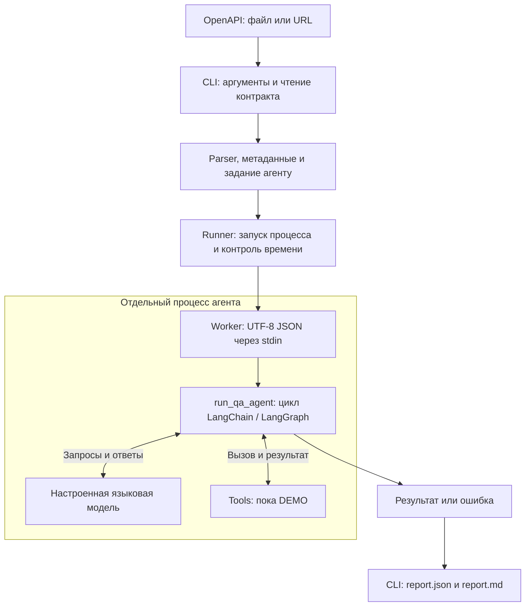

# ARQA-1 — CLI для запуска QA-агента по OpenAPI

ARQA-1 развивается как система генерации и проверки API-тестов по OpenAPI-контракту.
В ветке `model` реализован консольный интерфейс `arqa-testgen`: он принимает контракт,
готовит задание для LangChain-агента, контролирует запуск и сохраняет результат.

**Текущее состояние:** CLI подключён к агенту, но два доступных tools являются
демонстрационными заглушками. Реальная проверка API, фаззинг, генерация pytest-файлов
и исполнение сгенерированных тестов ещё не подключены. `success` в отчёте означает,
что агент вернул ответ, а не что API успешно прошёл тестирование.

Реализацию проверяют **55 автоматических тестов**. Они проверяют сам проект,
включая интеграцию CLI с настоящим LangChain-циклом через локальный имитатор LLM.
Это не тесты, сгенерированные агентом для пользовательского API.

[Проверки GitHub Actions](https://github.com/OsipShmel/arqua-1/actions/workflows/cli.yml)
запускаются на Windows и Linux с Python 3.11 и 3.14.

## Содержание

- [Что реализовано](#что-реализовано)
- [Как устроен запуск](#как-устроен-запуск)
- [Установка](#установка)
- [Настройка модели](#настройка-модели)
- [Команды CLI](#команды-cli)
- [Отчёты и коды завершения](#отчёты-и-коды-завершения)
- [Проверка реализации](#проверка-реализации)
- [Демонстрация проекта](#демонстрация-проекта)
- [Структура репозитория](#структура-репозитория)
- [Частые проблемы](#частые-проблемы)
- [Ограничения и следующий этап](#ограничения-и-следующий-этап)

## Что реализовано

| Возможность | Поведение текущей версии |
| --- | --- |
| Чтение контракта | Локальный JSON/YAML-файл или HTTP(S) URL, UTF-8 с поддержкой BOM |
| Базовая проверка | Командный `OpenAPIParser`: OpenAPI 3.x, сведения об API и HTTP-операции |
| Подготовка контекста | Исходный документ передаётся один раз как компактный JSON |
| Сохранность данных | Сохраняются `multipleOf`, `const`, `null`, расширения, `security`, `securitySchemes` и разделы `components` |
| Обращение к агенту | Вызов `run_qa_agent(task, max_steps=...)` через отдельный процесс |
| Управление tools | Инструменты выбирает и вызывает агент; CLI не обращается к tools напрямую |
| Ограничение времени | Таймаут загрузки контракта, таймаут LLM-запроса и общий срок процесса агента |
| Ограничение цикла | Настраиваемый `recursion_limit` LangGraph через `--max-steps` |
| Прерывание | Остановка локального процесса агента при таймауте или Ctrl+C |
| Отчёты | Отдельный каталог каждого запуска, `report.json` и `report.md` |
| Машинный вывод | `--format json`; диагностика идёт в stderr, результат — в stdout |
| Проверка настроек | Команда `doctor` без запросов к провайдеру |
| Работа с ошибками | Понятные сообщения, коды завершения, скрытие ключа провайдера в обрабатываемых ошибках |
| Проверки разработки | pytest, Ruff и CI на двух ОС и двух версиях Python |

Дополнительно parser оформлен как отдельный пакет uv workspace. Для установленной
версии LangChain используется параметр `system_prompt` при создании агента.
Демонстрационные tools явно сообщают, что проверки не выполнялись; они не возвращают
выдуманные HTTP-статусы, дефекты или метрики.

## Как устроен запуск



Один запуск `generate` проходит следующие этапы:

1. CLI проверяет аргументы и создаёт каталог с UTC-временем и уникальным ID.
2. Читает контракт из файла или загружает его по URL. Формат определяется по содержимому,
   поэтому URL не обязан заканчиваться на `.json` или `.yaml`.
3. Parser выполняет базовую проверку и извлекает метаданные. Контракт должен содержать
   хотя бы одну HTTP-операцию.
4. CLI формирует задание: адрес сервиса, источник контракта и компактный JSON документа.
   Контракт обозначается как данные, инструкции внутри него не должны исполняться агентом.
5. Runner запускает `python -m agent.worker` тем же Python, которым работает CLI.
   Задание передаётся через stdin, поэтому большой JSON не попадает в аргументы процесса.
6. Worker вызывает `run_qa_agent`. Агент создаёт модель, выбирает tools и возвращает ответ.
7. CLI проверяет структуру результата, записывает отчёты и возвращает код завершения.

### Зачем нужна функция агента

`run_qa_agent` — согласованная точка входа между CLI и агентной частью.
CLI отвечает за пользовательский запуск, ввод, ограничения и файлы результатов.
Агент отвечает за работу с моделью и самостоятельные вызовы tools.

Текущий интерфейс:

```python
run_qa_agent(task: str, *, max_steps: int = 25) -> dict
```

При успешном завершении агент возвращает:

```python
{
    "status": "success",
    "output": final_message_content,
    "tool_mode": "demo",
}
```

`output` — содержимое последнего сообщения модели: текст или блоки содержимого.
Ошибки выполнения функции перехватывает worker и возвращает CLI поля `status: "error"`,
`error` и `error_type`. Сам `run_qa_agent` может выбросить исключение.
Прямой вызов функции из Python не получает общий таймаут процесса: этот контроль
реализован в CLI через runner.

### Какие tools доступны

| Tool | Назначение | Реальное поведение сейчас |
| --- | --- | --- |
| `check_api_health(url)` | Проверка доступности API | Возвращает сообщение `[DEMO]`, HTTP-запрос не выполняет |
| `run_contract_fuzzing(spec_path, target_url)` | Фаззинг по OpenAPI | Возвращает сообщение `[DEMO]`, фаззинг не запускает |

Эти tools зарегистрированы в агенте. Рабочий HTTP-фасад внешних tools в текущий
CLI не подключён; наличие пакета `testing_tools` в workspace не означает, что агент
уже использует его реализацию.

## Установка

### Основной вариант: uv workspace

Для всего workspace нужен **Python 3.14+**, Git и установленный `uv`.
Пакеты `agent` и `arqa-openapi-parser` отдельно допускают Python 3.11+;
корневой проект и `testing-tools` требуют 3.14.

Для нового клона:

```bash
git clone --branch model https://github.com/OsipShmel/arqua-1.git
cd arqua-1
uv sync --locked --all-packages --all-extras
uv run --locked arqa-testgen --help
uv run --locked arqa-testgen --version
```

Все дальнейшие команды с `uv run --locked` выполняются из корня репозитория.
Установка использует `uv.lock`, включает parser и зависимости для разработки.
Справка и версия работают без настроенной модели.

### Отдельная установка CLI на Python 3.11+

В отдельном активированном виртуальном окружении Python 3.11+ из корня репозитория:

```bash
python -m pip install -e ./openapi_parser_project -e './backend/agent[dev]'
python -m agent --help
```

Здесь устанавливаются только CLI, агент и parser, без корневого workspace.
Для этой установки используйте `arqa-testgen` или `python -m agent`, а для тестов —
`python -m pytest`. `uv run --locked` из корня относится к workspace с Python 3.14+.

### Если uv запускается по полному пути

В PowerShell можно задать путь к установленному `uv.exe`:

```powershell
$uv = 'C:\path\to\uv.exe'
& $uv sync --locked --all-packages --all-extras
& $uv run --locked arqa-testgen --help
```

Замените путь на свой. В остальных примерах заменяйте `uv` на `& $uv`.
Привязка к определённому пути на компьютере разработчика проекту не требуется.

## Настройка модели

Нужен провайдер с OpenAI-compatible API и модель, поддерживающая tool calling.
Адрес провайдера и название доступной модели следует получить у команды или из
настроек своего провайдера. Пример `.env` не создаёт аккаунт и не выдаёт API-ключ.

Создайте `.env` в корне проекта или скопируйте шаблон
[backend/agent/.env.example](backend/agent/.env.example) и замените его значения:

```dotenv
DEEPCODE_API_KEY=your_real_api_key
DEEPCODE_BASE_URL=https://your-provider.example/v1
DEEPCODE_MODEL=your_model_name
DEEPCODE_TEMPERATURE=0
DEEPCODE_TIMEOUT=60
```

Адрес и название выше — placeholders, их нельзя использовать как готовые настройки.

| Переменная | Обязательна | Назначение |
| --- | --- | --- |
| `DEEPCODE_API_KEY` | Да | Ключ доступа к провайдеру |
| `DEEPCODE_BASE_URL` | Да | HTTP(S) адрес API провайдера без учётных данных в URL |
| `DEEPCODE_MODEL` | Да | Название модели у этого провайдера |
| `DEEPCODE_TEMPERATURE` | Нет | Конечное число от 0 до 2; по умолчанию 0 |
| `DEEPCODE_TIMEOUT` | Нет | Положительный таймаут отдельного запроса к LLM; по умолчанию 60 секунд |
| `SSL_CERT_FILE` | Нет | Пользовательский файл сертификатов; существующая настройка сохраняется |

Переменные процесса имеют приоритет над `.env`. Загрузчик сначала ищет ближайший
`.env` в дереве установленного модуля, затем читает `.env` из текущего каталога,
не перезаписывая уже заданные значения. Поэтому найденный возле пакета `.env`
также имеет приоритет над файлом из текущего каталога.

Ключ не передаётся CLI-флагом, `.env` исключён из Git. `doctor` не выводит значения
секретов; обрабатываемые ошибки модели скрывают значение `DEEPCODE_API_KEY`.
При настоящем запуске контракт передаётся настроенной языковой модели.

## Команды CLI

### `doctor`: локальная проверка настроек

```bash
uv run --locked arqa-testgen doctor
uv run --locked arqa-testgen doctor --format json
```

Проверяются Python, наличие установленных пакетов, обязательные настройки модели,
URL провайдера, температура, таймаут и наличие файла `SSL_CERT_FILE`, если он задан.
Команда не создаёт LLM-клиент и не делает сетевых запросов. Она не подтверждает
действительность ключа, доступность провайдера или поддержку tool calling.

Отсутствующие настройки дают `[error] model_settings` и код 1.
`[warning] tools` сообщает о заглушках и само по себе не делает диагностику неуспешной.
В JSON поле `network_checked` равно `false`.

### `generate`: запуск агента

Контракт из репозитория:

```bash
uv run --locked arqa-testgen generate openapi_parser_project/examples/pets.yaml --base-url http://localhost:8080
```

Контракт по URL и машиночитаемый результат:

```bash
uv run --locked arqa-testgen generate http://localhost:8080/openapi.json --base-url http://localhost:8080 --output ./runs --format json
```

С ограничениями выполнения:

```bash
uv run --locked arqa-testgen generate openapi_parser_project/examples/pets.yaml --base-url http://localhost:8080 --agent-timeout 120 --max-steps 15
```

`--base-url` — адрес тестируемого сервиса. Он отличается от `DEEPCODE_BASE_URL`,
который указывает на API языковой модели. Контракт из файла не требует загрузки
по сети; контракт по URL должен быть доступен с компьютера, где запущен CLI.
Для путей с пробелами используйте кавычки.

| Аргумент или флаг | Значение по умолчанию | Назначение |
| --- | --- | --- |
| `contract` | Обязателен | Путь к контракту или HTTP(S) URL |
| `--base-url` | Обязателен | Адрес тестируемого API |
| `--output` | `runs` | Родительский каталог результатов |
| `--format` | `text` | Формат stdout: `text` или `json` |
| `--contract-timeout` | `10` | Положительный таймаут HTTP-загрузки контракта, секунды |
| `--agent-timeout` | `300` | Максимальное время процесса агента, секунды |
| `--max-steps` | `25` | Положительный предел шагов графа LangGraph |
| `--help` | — | Справка, доступна также для `doctor` и `generate` |
| `--version` | — | Версия установленного пакета агента |

### Как работают ограничения

- `--contract-timeout` ограничивает ожидание при HTTP-загрузке; это настройка HTTPX,
  а не общий срок всех этапов программы.
- `DEEPCODE_TIMEOUT` ограничивает отдельный запрос к LLM. Клиент допускает одну
  повторную попытку для ошибок, которые его SDK считает допускающими повтор.
- `--agent-timeout` охватывает создание модели и весь цикл агента, включая запросы,
  повторы и tools. Чтение контракта и сохранение отчётов выполняются вне этого срока.
- `--max-steps` передаётся как `recursion_limit`. Это шаги графа, а не точное число
  LLM-запросов или вызовов tools. Превышение приводит к `GraphRecursionError`.

При таймауте или Ctrl+C CLI завершает локальный процесс агента и сохраняет отчёт,
если каталог доступен для записи. Это не отменяет уже начатую удалённую операцию
или отдельные процессы будущих tools.

## Отчёты и коды завершения

Каждая попытка `generate` получает отдельный каталог:

```text
runs/
  <UTC-время>-<уникальный-ID>/
    report.json
    report.md
```

`report.md` содержит сведения о запуске, лимиты, объяснение демонстрационного режима,
ответ агента или ошибку. `report.json` предназначен для автоматической обработки:

| Поле | Содержимое |
| --- | --- |
| `schema_version` | Версия структуры отчёта, сейчас 1 |
| `run_id` | UTC-время и уникальный идентификатор |
| `status` | `success`, `error`, `timeout` или `interrupted` |
| `started_at`, `finished_at` | Время начала и завершения в UTC |
| `contract` | Источник, SHA-256 исходных байтов, сведения об API и число операций |
| `target_base_url` | Адрес тестируемого API |
| `tool_mode` | Сейчас всегда `demo` |
| `agent` | Результат агента или `null`, если результат не получен |
| `metrics` | Сейчас `null`: настоящие метрики не рассчитываются |
| `generated_tests` | Сейчас `[]`: pytest-файлы не генерируются |
| `error` | Тип и сообщение ошибки или `null` |
| `artifacts` | Абсолютные пути к JSON и Markdown |
| `limits` | Применённые `agent_timeout` и `max_steps` |

При ошибке чтения контракта его полные метаданные недоступны: сохраняется только
переданный источник. Отчёты ошибок создаются, если каталог удалось подготовить.
Ошибки разбора CLI-аргументов, `--help`, `--version` и `doctor` не создают каталог прогона.

Каждый файл записывается через временный файл и атомарную замену. Прошлые прогоны
не перезаписываются. Пара файлов не является одной транзакцией: при ошибке диска
может сохраниться только один отчёт, а CLI завершится с ошибкой.

В режиме `--format json` stdout содержит один JSON-документ в UTF-8.
Этапы запуска и вывод агента направляются в stderr. При перенаправлении используйте
раздельные потоки; например, в Bash:

```bash
uv run --locked arqa-testgen generate openapi.yaml --base-url http://localhost:8080 --format json > result.json 2> diagnostics.log
```

При чтении отчётов из Python явно задавайте кодировку:

```python
import json
from pathlib import Path

report = json.loads(Path("runs/<run-id>/report.json").read_text(encoding="utf-8"))
```

| Код завершения | Значение |
| --- | --- |
| `0` | Успешный ответ агента; для `doctor` — успешная локальная проверка |
| `1` | Ошибка чтения, настроек, модели, шагов графа, результата или сохранения |
| `2` | Неверные или отсутствующие аргументы |
| `124` | Истёк срок процесса агента |
| `130` | Запуск прерван пользователем через Ctrl+C |

## Проверка реализации

### Автоматические тесты без ключа модели

```bash
uv run --locked --package agent pytest backend/agent/tests openapi_parser_project/tests -q
```

В текущей версии ожидается `55 passed`. Тесты используют временные контракты,
локальный HTTP-сервер и тестовые настройки, поэтому не обращаются к внешней LLM
и не требуют настоящего API-ключа.

На Windows при недоступном `%TEMP%\pytest-of-<user>` используйте новую папку
для каждого прогона. Эта команда проверена на компьютере разработчика:

```powershell
New-Item -ItemType Directory -Path .pytest-tmp -Force | Out-Null
$testTemp = Join-Path (Get-Location).Path ('.pytest-tmp/' + [guid]::NewGuid().ToString('N'))
uv run --locked --package agent pytest backend/agent/tests openapi_parser_project/tests -q --basetemp $testTemp
```

При использовании переменной с путём к uv замените последнюю строку на:

```powershell
& $uv run --locked --package agent pytest backend/agent/tests openapi_parser_project/tests -q --basetemp $testTemp
```

`.pytest-tmp/` исключён из Git. pytest очищает указанный `--basetemp` перед запуском,
поэтому выбирайте новый каталог с UUID, а не папку с нужными файлами.

### Что именно проверяют тесты

| Группа | Проверяемые сценарии |
| --- | --- |
| CLI | JSON stdout, отдельные прогоны, отчёты, ошибки ввода и агента, Ctrl+C, таймаут, проверка флагов |
| Контракты | JSON/YAML, числовые YAML-коды ответов, HTTP-загрузка, HTTP-ошибки, базовая валидация, сохранность полей |
| Модель | Настройки, обязательные переменные, приоритет окружения над `.env`, сохранение настройки сертификатов |
| Doctor | Корректные и ошибочные настройки, отсутствие вывода ключа, отсутствие создания клиента |
| Runner | Передача задания через stdin, завершение и ожидание процесса при таймауте или прерывании |
| Интеграция | Установленный CLI, настоящий LangChain и OpenAI-клиент, полный цикл tool calling, файл/URL и артефакты |
| Ошибки провайдера | Зависший ответ, повторяющиеся tools до лимита графа, ошибка авторизации со скрытием ключа |
| Parser | Проверки существующей реализации командного parser |

В интеграционном сценарии локальный сервер сначала возвращает вызов
`check_api_health`, затем принимает сообщение с результатом tool и выдаёт финальный
ответ. Выбор tools имитирует сервер; их выполнение и обмен сообщениями проходят
через настоящий агент. Это подтверждает программную интеграцию, но не качество
решений настоящей модели и не корректность тестируемого API.

### Lint, форматирование и CI

```bash
uv run --locked --package agent ruff check backend/agent/src backend/agent/tests
uv run --locked --package agent ruff format --check backend/agent/src backend/agent/tests
```

Workflow [`.github/workflows/cli.yml`](.github/workflows/cli.yml) запускается на push
и pull request. Матрица: `ubuntu-latest` / `windows-latest` × Python 3.11 / 3.14.
На 3.14 устанавливается workspace по `uv.lock`; на 3.11 — только CLI и parser
с зависимостями для разработки, поскольку весь workspace требует 3.14.
Таким образом, проверка 3.11 тестирует совместимость отдельного пакета и допускаемых
им зависимостей, а не воспроизведение корневого lock-файла. Секреты LLM в CI не нужны.

## Демонстрация проекта

Для демонстрации преподавателю или команде:

1. Показать `arqa-testgen --help` и поддерживаемые параметры.
2. Запустить автоматические тесты и показать `55 passed`.
3. Настроить действительного провайдера и выполнить `doctor`.
4. Запустить `generate` на `openapi_parser_project/examples/pets.yaml`.
5. Открыть полученные `report.json` и `report.md`: источник, число операций,
   результат агента, режим, лимиты и состояние запуска.
6. Объяснить, что заглушки tools пока не выполняют проверку сервиса и генерацию кода.

Для демонстрации взаимодействия с настоящей моделью нужен настроенный провайдер.
Без ключа доступны справка, диагностика отсутствующих настроек и автоматические тесты
с локальным имитатором. Эти два способа проверки подтверждают разные вещи.

Краткое описание выполненной части:

> Реализован CLI для ARQA-1: ввод OpenAPI из файла или URL, подготовка задания и вызов
> LangChain-агента, ограничения времени и шагов, обработка ошибок и отчёты JSON/Markdown.
> Агент самостоятельно управляет tools. Добавлена локальная диагностика настроек,
> 55 автоматических тестов и CI на Windows/Linux с Python 3.11/3.14.
> Рабочие инструменты генерации и исполнения API-тестов ещё предстоит подключить.

## Структура репозитория

```text
.
├── README.md                           # Руководство по текущей реализации
├── pyproject.toml                      # uv workspace, Python 3.14+
├── uv.lock                             # Зафиксированные зависимости workspace
├── .github/workflows/cli.yml            # Матрица тестов и Ruff
├── backend/
│   ├── agent/
│   │   ├── pyproject.toml               # Пакет agent, Python 3.11+, console script
│   │   ├── .env.example                 # Шаблон настроек модели
│   │   ├── README.md                    # Интерфейс и устройство пакета агента
│   │   ├── src/agent/
│   │   │   ├── __main__.py              # Запуск python -m agent
│   │   │   ├── cli.py                   # Аргументы, команды и отчёты
│   │   │   ├── contracts.py             # Чтение и контекст OpenAPI
│   │   │   ├── runner.py                # Процесс агента, таймаут и остановка
│   │   │   ├── worker.py                # JSON-протокол и вызов run_qa_agent
│   │   │   ├── doctor.py                # Локальная диагностика
│   │   │   ├── model.py                 # Настройки и фабрика ChatOpenAI
│   │   │   └── agent.py                 # LangChain-агент и DEMO tools
│   │   └── tests/                       # CLI, модель, контракты и интеграция
│   └── testing_tools/                   # Отдельный пакет tools в workspace
└── openapi_parser_project/
    ├── openapi_parser/                  # Командный parser и модели
    ├── examples/pets.yaml               # Контракт для ручного запуска
    └── tests/                           # Проверки parser
```

## Частые проблемы

| Симптом | Что проверить или сделать |
| --- | --- |
| `uv` не найден | Установить uv или вызвать существующий `uv.exe` по полному пути |
| Workspace не запускается на Python 3.11 | Для workspace использовать 3.14+; для 3.11 установить CLI и parser отдельно |
| `doctor`: отсутствуют `DEEPCODE_*` | Заполнить три обязательные настройки и проверить расположение `.env` |
| `doctor` успешен, но модель недоступна | Он проверяет локальные настройки; проверить настоящий адрес, ключ, модель и поддержку tools |
| `[warning] tools` | Ожидаемое состояние текущей версии: tools демонстрационные |
| Файл контракта не найден | Проверить текущий каталог и заключить путь с пробелами в кавычки |
| В контракте нет HTTP-операций | Передать OpenAPI 3.x с операциями в `paths`; одна секция схем не подходит |
| `GraphRecursionError` | Агент не закончил работу за указанное число шагов; изучить провайдера и поведение цикла |
| Код `124` | Истёк общий срок агента; проверить провайдера и выбранный `--agent-timeout` |
| `PermissionError` в `pytest-of-<user>` | Запустить тесты с уникальным `--basetemp` по примеру выше |
| Ошибка чтения отчёта на Windows | Читать файл как UTF-8, например `read_text(encoding="utf-8")` |
| Не удаётся сохранить отчёт | Проверить права на `--output` и свободное место |

## Ограничения и следующий этап

В текущей реализации:

- tools не обращаются к тестируемому API и не запускают фаззинг;
- нет генерации pytest-файлов, изолированного исполнения тестов и self-repair;
- `tool_mode: "demo"`, `metrics: null` и `generated_tests: []` заданы явно;
- parser выполняет базовую проверку, а не полную валидацию по стандарту OpenAPI;
- локальные определения `$ref` сохраняются в документе, но CLI не разрешает ссылки
  и не загружает внешние определения автоматически;
- большие контракты отправляются целиком; разбиение по операциям и ограничение
  контекста по токенам пока не реализованы;
- остановка локального агента не является протоколом отмены удалённых tools;
- качество ответа реальной LLM требует отдельной проверки с выбранным провайдером.

Для следующего этапа команде необходимо:

1. Настроить модель с поддержкой tool calling и проверить ручной запуск.
2. Подключить реальные tools к агенту, сохранив управление ими в агентной части.
3. Согласовать расширенный результат `run_qa_agent`: пути pytest-файлов,
   результаты исполнения, метрики, ошибки и фактический режим tools.
4. Обновить CLI и отчёты для сохранения этих результатов и убрать жёстко заданный demo-режим.
5. Добавить проверки реального сценария: контракт → агент → генерация → исполнение → отчёт.
